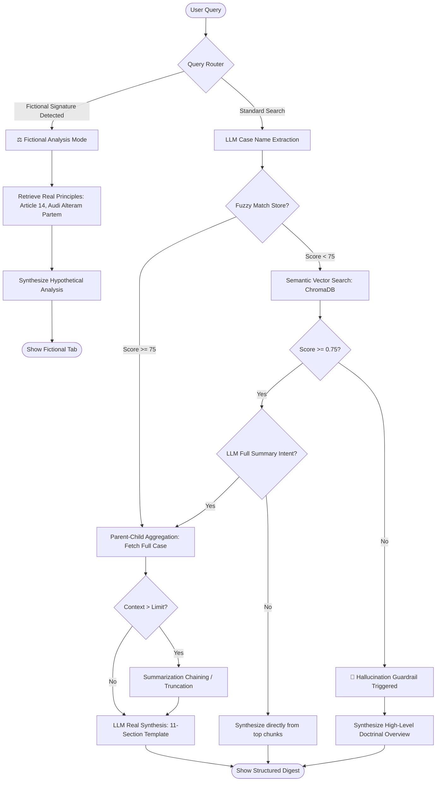

# Verdict-Legal_Judgment_RAG

This repository contains the RAG prototype for legal judgment retrieval.


### *Retrieval-Augmented Generation (RAG) for Indian Supreme Court Jurisprudence*

[](https://streamlit.io/)
[](https://opensource.org/licenses/MIT)
[](https://www.python.org/downloads/)

VERDICT is a domain-aware, locally deployable and cloud-compatible **Retrieval-Augmented Generation (RAG)** system designed specifically for retrieving, verifying, and distilling long-form Indian Supreme Court judgments. 

Standard Large Language Models (LLMs) frequently hallucinate fake case names, misattribute precedents, or fail to capture the formal structures of legal reasoning. VERDICT solves this through a structured Parent-Child retrieval strategy, hybrid fuzzy case routing, semantic threshold guardrails, and fictional scenario bypasses.

---

## 🚀 Key Features

*   **Dual Ingestion & Inference Modes**:
    *   **Local Mode**: Fully offline, running locally via **Ollama** (Llama 3 8B) and **BAAI/bge-base-en-v1.5** embeddings on CPU/GPU.
    *   **Cloud API Mode**: Quick, lightweight cloud execution using the **Google Gemini API** (Gemini 2.5 Flash / Gemini 1.5 Pro) for synthesis, while retaining local embeddings for database queries.
*   **Parent-Child RAG Architecture**: Retrieval operates on optimized, small child chunks (paragraph-level) for maximum semantic matching precision, but the generation phase aggregates the parent context (the entire document structure) to preserve the legal narrative.
*   **Intelligent Query Routing**:
    *   *Fuzzy Case Matching*: Automatically extracts case names from noisy queries (using LLMs) and matches them using Token Set Ratio (FuzzyWuzzy) against a structured catalog of over 1,000 Supreme Court entries.
    *   *Direct Context Aggregation*: Bypasses chunk fragmentation by retrieving the entire document context when direct matches succeed.
*   **Anti-Hallucination Guardrails**:
    *   *Semantic Rejection*: If the top semantic chunk distance falls below the acceptance threshold (`0.75`), the system refuses to fabricate a case and instead generates a structured doctrinal overview.
    *   *Fictional Override*: Automatically detects queries referencing hypothetical cases (e.g. Adv. Ritesh Varma vs Ministry of Digital Affairs 2029) and routes them to a special analysis mode grounded in real constitutional principles (Article 14, Natural Justice, Proportionality).
*   **Premium Streamlit Dashboard**: Overhauled interface featuring glassmorphic design tabs, real-time database case selectors, step-by-step pipeline execution logs, and semantic chunk score transparency.

---

## 📐 System Architecture



---

## 📂 Repository Structure

```
├── data/
│   ├── chroma_store/            # Active ChromaDB vector store directory
│   │   └── parent_metadata.json # Case catalog with headnotes, benches, and citations
│   └── structured_judgments.json# Source legal metadata used for database creation
├── docs/
│   ├── presentation/
│   │   └── verdict_Amarthya_1AY23CD066.pptx # Final project presentation slides
│   └── ILC_MODEL_EVALUATION_SUITE.md        # Evaluation scenarios & benchmarks
├── experimental/                # Archive of drafts, failed attempts, and CLI tests
│   ├── old_dbs/                 # Older versions of Chroma DB (chroma_store1, BORE_06_27)
│   ├── CLI_backends/            # Command line versions (FInalMain, equallytunedBOTH)
│   └── query_tests/             # Early query experiments (nomic, llama-cpp-python GGUF)
├── app.py                       # Unified, high-aesthetic Streamlit application (Entrypoint)
├── persistent_embedder.py       # Core document parser and vector store ingestion builder
├── MakeQA.py                    # RAGAS synthetic testset evaluation generator
├── DEVELOPMENT_HISTORY.md       # Detailed guide explaining historical versions and experiments
├── requirements.txt             # Python dependencies
└── .gitignore                   # Excludes environments, local keys, and private papers
```

---

## ⚙️ Setup & Installation

### 1. Clone & Set Up Environment
```bash
git clone https://github.com/AmarthyaT/Verdict-Legal_Judgment_RAG.git
cd Verdict-Legal_Judgment_RAG

# Create virtual environment
python -m venv venv
# Activate environment (Windows)
venv\Scripts\activate
# Activate environment (Mac/Linux)
source venv/bin/activate

# Install dependencies
pip install -r requirements.txt
```

### 2. Configure Generation Engine (Choose One or Both)

#### Option A: Local Inference (Ollama)
1. Download and install [Ollama](https://ollama.com/).
2. Pull the default Llama 3 model in your terminal:
   ```bash
   ollama pull llama3
   ```
3. Keep the Ollama service running in the background (`ollama serve`).

#### Option B: Cloud Inference (Gemini API)
1. Obtain a Gemini API Key from Google AI Studio.
2. Set it as an environment variable (or type it directly into the Streamlit sidebar at runtime):
   ```bash
   # Windows (CMD)
   set GEMINI_API_KEY=your_api_key_here
   # Windows (PowerShell)
   $env:GEMINI_API_KEY="your_api_key_here"
   # Mac/Linux
   export GEMINI_API_KEY="your_api_key_here"
   ```

---

## 🖥️ Running the Application

Launch the Streamlit web dashboard:
```bash
streamlit run app.py
```
Open `http://localhost:8501` in your browser. The sidebar allows you to select the generation engine, view database stats, and browse through the preloaded judgment catalog.

---

## 🔧 Database Ingestion & Re-building

The active database in `data/chroma_store` comes pre-loaded with Supreme Court judgments. If you wish to rebuild the vector store or embed new PDFs:

1. Place your judgment PDFs in a local folder.
2. Open `persistent_embedder.py` and verify `CHUNK_SIZE` and `CHUNK_OVERLAP` variables.
3. Run the ingestion pipeline (using BGE embeddings on CUDA if available, otherwise CPU):
   ```bash
   python persistent_embedder.py --pdf_folder "path/to/your/pdf/folder"
   ```

---

## 🧠 Fine-Tuned Model: Indian Legal Llama 3.1

This project is optimized to run with a custom fine-tuned model specifically trained for abstractive legal summarization:

*   **Model Repository**: [Amarthya11/Llama3.1-finetuned-GGUF](https://huggingface.co/Amarthya11/Llama3.1-finetuned-GGUF)
*   **Base Model**: `unsloth/meta-llama-3.1-8b-unsloth-bnb-4bit` (Fine-tuned using Unsloth & QLoRA)
*   **Dataset**: Trained on the **Indian Legal Corpus (ILC)**, which features highly abstractive human-written legal summaries. This enables the model to capture deep semantic intent and reasoning structures rather than just copying text.
*   **Quantization**: Provided in **GGUF** format (`unsloth.Q4_K_M.gguf`, ~4.92 GB) for optimized local CPU and GPU execution.

### Running the Fine-Tuned Model in Ollama:
To run this custom model offline in the RAG pipeline:
1. Download the GGUF file (`unsloth.Q4_K_M.gguf`) from [Hugging Face](https://huggingface.co/Amarthya11/Llama3.1-finetuned-GGUF/blob/main/unsloth.Q4_K_M.gguf).
2. Create a text file named `Modelfile` in the same directory:
   ```dockerfile
   FROM ./unsloth.Q4_K_M.gguf
   
   # Set the standard Llama 3 prompt template
   TEMPLATE "{{ if .System }}<|start_header_id|>system<|end_header_id|>\n\n{{ .System }}<|eot_id|>{{ end }}{{ if .Prompt }}<|start_header_id|>user<|end_header_id|>\n\n{{ .Prompt }}<|eot_id|>{{ end }}<|start_header_id|>assistant<|end_header_id|>\n\n{{ .Response }}<|eot_id|>"
   
   SYSTEM "You are a Legal RAG Agent specializing in Indian Law. Synthesize the provided context to answer the user query."
   
   PARAMETER temperature 0.1
   PARAMETER stop "<|start_header_id|>"
   PARAMETER stop "<|end_header_id|>"
   PARAMETER stop "<|eot_id|>"
   ```
3. Compile the model in Ollama:
   ```bash
   ollama create verdict-llama3.1 -f ./Modelfile
   ```
4. In the Streamlit app sidebar, set **Local Ollama Model Name** to `verdict-llama3.1`.

---

## 📈 Evaluation

Synthetic question-answering evaluation pairs can be generated using `MakeQA.py`, which utilizes the RAGAS framework and the Gemini API.

To generate a synthetic legal dataset:
```bash
python MakeQA.py
```
*Note: Make sure your `GEMINI_API_KEY` environment variable is exported.*

For details on the evaluation methodology, testing for hallucination traps, and measuring context adherence, refer to **[ILC_MODEL_EVALUATION_SUITE.md](file:///c:/Users/tamar/Desktop/programming/github_repos/rag_proto/docs/ILC_MODEL_EVALUATION_SUITE.md)**.

---

